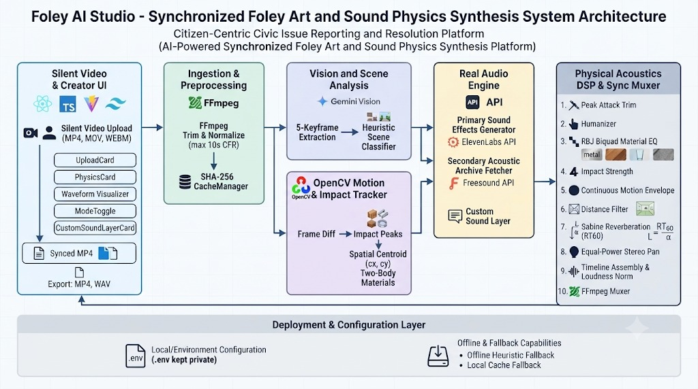
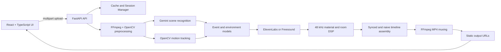

# Foley AI Studio

**Turn silent video into physically shaped, frame-synchronized sound.**

Foley AI Studio is a full-stack multimodal application that analyzes a video, detects visual action and impact events, retrieves or generates real-world audio, and mixes that audio onto the exact video timeline. It combines **Gemini scene understanding**, **OpenCV motion tracking**, **real audio engines**, and a deterministic **Sabine/RBJ DSP pipeline** so judges and users can compare a rough baseline against frame-accurate, physically shaped output.

## Demo in 30 Seconds

1. Upload a silent clip up to 10 seconds.
2. **Analyze Clip**: inspect the detected room, motion curve, materials, and impact events.
3. **Generate Foley**: create a synchronized master track and a naive baseline.
4. Compare **Naive** versus **Physics-Synced** playback.
5. Edit event materials, room size, wall absorption, impact intensity, and sync nudge.
6. Download the synchronized MP4 or WAV.

```text
Silent video
     |
     v
+-------------------------+
|  Gemini + OpenCV        |  Scene understanding, motion peaks,
|  Vision Analysis        |  centroids, materials, event timing
+-------------------------+
     |
     v
+-------------------------+
|  Real Audio Retrieval   |  ElevenLabs first, Freesound fallback
+-------------------------+
     |
     v
+-------------------------+
|  48 kHz Stereo DSP      |  Material EQ, distance, impact gain,
|  Physics Pipeline       |  stereo pan, Sabine reverb
+-------------------------+
     |
     v
+-------------------------+
|  FFmpeg Video Assembly  |  Naive MP4 + physics-synced MP4 + WAV
+-------------------------+
```

## Why It Is Different

This project does not drop generic stock clips onto a rough timestamp and stop there.

| Foley AI capability | What happens under the hood |
|---|---|
| **Frame-accurate placement** | OpenCV detects motion peaks and aligns rendered hits to video frames with a configurable nudge. |
| **Spatial awareness** | Motion centroid location becomes stereo pan, placing events left or right in the mix. |
| **Impact sensitivity** | Kinetic strength derived from motion affects transient gain and low-pass shaping. |
| **Two-body material design** | Collider and surface materials are combined into separate deterministic RBJ biquad EQ chains. |
| **Acoustic room modeling** | Sabine RT60 is calculated from room length and wall absorption rather than chosen as an arbitrary stock preset. |
| **Baseline comparison** | A naive track is retained alongside the synchronized physics-mixed track. |
| **Real audio sources** | ElevenLabs can generate sound effects and Freesound supplies downloaded real recordings. |
| **Offline event fallback** | When Gemini is unavailable, OpenCV motion heuristics produce a usable offline analysis. |
| **Editable timeline** | Event type, collider, surface, distance, prompt, room, energy, and frame offset remain controllable after analysis. |

## Product Walkthrough

### 1. Upload and analyze

- Accepts MP4, MOV, or WebM uploads.
- Preprocessing validates the media, trims it to 10 seconds, and prepares a processed MP4.
- Gemini receives sampled keyframes for scene, environment, events, and ambient prompts.
- OpenCV identifies motion peaks, event timing, impact strength, and screen-space centroids.
- The UI displays the normalized motion curve and detected event list.

### 2. Edit the scene

The event editor can change:

- Impact or continuous event type
- Collider material
- Surface material
- Near, mid, or far distance
- Natural-language sound prompt

Room controls expose:

- Small room, large hall, cave, or open field presets
- Custom room length
- Wall materials and absorption
- Global impact intensity
- Frame-level sync nudge

### 3. Generate and shape

The backend performs a 48 kHz real-audio assembly:

1. Resolve a real clip with ElevenLabs or Freesound.
2. Locate the dry clip's attack before reverb.
3. Apply collider and surface EQ.
4. Apply distance attenuation and low-pass filtering.
5. Scale gain from impact strength and intensity.
6. Apply stereo pan from the motion centroid.
7. Add a deterministic Sabine-style impulse response.
8. Normalize and soft-limit the final stereo track.
9. Assemble the synchronized track and naive baseline.
10. Mux both tracks to MP4 and export the synchronized WAV.

### 4. Compare and export

The master stage provides three playback modes:

- **Silent** original video
- **Naive** timeline-baseline audio
- **Physics-synced** frame-aligned output

Users can also seek the waveform, view detected peaks, download the synced MP4, and download the WAV.

## System Architecture



*End-to-end architecture: React upload and studio controls feed FastAPI ingestion, Gemini/OpenCV analysis, real audio retrieval, physical DSP shaping, FFmpeg assembly, and downloadable outputs.*



### Backend modules

| Module | Responsibility |
|---|---|
| `main.py` | FastAPI routes, sessions, health, static mounts, audio generation orchestration |
| `vision_tracker.py` | Gemini integration, keyframe recognition, OpenCV motion peaks, offline fallback |
| `cache_manager.py` | Upload preprocessing, hashes, clip cache, and reusable analysis cache |
| `audio_generator.py` | ElevenLabs/Freesound selection and real clip normalization |
| `physics_dsp.py` | RBJ filters, impact shaping, stereo pan, distance mixing, and Sabine reverb |
| `sync_muxer.py` | Naive/synced timeline assembly, peaks, waveform bins, and MP4 muxing |
| `services/audio_engine.py` | External audio engine requests and FFmpeg merge operations |
| `schemas.py` | Pydantic API models and enum normalization |
| `tests/` | Demo-video generation and backend smoke-test utilities |

### Frontend modules

| Area | Responsibility |
|---|---|
| `src/App.tsx` | Main page composition |
| `components/studio/` | Upload, event editing, physics, waveform, playback, and custom layers |
| `components/config/hooks/useStudio.ts` | Studio state machine and backend workflow |
| `src/client.ts` | API transport and mock-mode switching |
| `src/types.ts` | Typed API contracts |
| `src/lib/rooms.ts` | Room presets and local RT60 estimation |
| `src/mock.ts` | Deterministic UI demo data |

## Tech Stack

### Frontend

- React 18
- TypeScript
- Vite
- Tailwind CSS
- Native Fetch API

### Backend

- Python
- FastAPI
- Pydantic 2
- Uvicorn
- NumPy and SciPy
- Librosa and SoundFile
- OpenCV
- FFmpeg
- Google Gemini SDK

### External services

- Gemini for multimodal scene and event understanding
- ElevenLabs for AI sound effects
- Freesound for searchable real-world audio recordings

## API

| Method | Endpoint | Purpose |
|---|---|---|
| `GET` | `/api/health` | Backend, FFmpeg, vision, and audio-engine status |
| `POST` | `/api/analyze-video` | Upload and analyze a silent video |
| `POST` | `/api/generate-audio` | Generate and mux synchronized and naive audio |
| `POST` | `/api/tweak-physics` | Re-render room, material, intensity, and sync changes |
| `POST` | `/api/add-custom-sound` | Add a prompt-generated audio layer to the session |
| `POST` | `/api/process-video` | Alternative end-to-end scene recognition and audio process route |
| `GET` | `/outputs/...` | Download generated MP4/WAV outputs |
| `GET` | `/uploads/...` | Preview processed uploads |
| `GET` | `/docs` | Interactive Swagger API documentation |

The backend accepts normal FastAPI multipart and JSON requests. Session state is returned by analysis and persisted on disk in `foley-backend/sessions/`.

## Run Locally

### Requirements

- Windows, macOS, or Linux
- Python 3.10+
- Node.js 18+
- npm
- FFmpeg available on `PATH`, or `imageio-ffmpeg`, which is installed with the Python requirements

### 1. Start the backend

```powershell
cd D:\foley-ai-studio\foley-backend
python -m venv .venv
.\.venv\Scripts\Activate.ps1
python -m pip install -r requirements.txt
Copy-Item .env.example .env
python -m uvicorn main:app --host 127.0.0.1 --port 8000 --reload
```

Create `foley-backend/.env`:

```dotenv
GEMINI_API_KEY=
GEMINI_MODEL=gemini-2.5-flash

ELEVENLABS_API_KEY=
FREESOUND_API_KEY=
```

- Gemini is used for scene and event understanding.
- Without Gemini, the system uses the implemented OpenCV/offline fallback.
- At least one audio key is required for real audio generation: ElevenLabs or Freesound.
- The health endpoint reports which integrations are currently configured.

### 2. Start the frontend

```powershell
cd D:\foley-ai-studio\foley-frontend
npm install
Copy-Item .env.example .env
npm run dev
```

Open `http://localhost:5173`.

For a frontend-only mock demo:

```dotenv
VITE_API_BASE=http://localhost:8000
VITE_USE_MOCK=1
```

### 3. Build the frontend

```powershell
cd D:\foley-ai-studio\foley-frontend
npm run build
npm run preview
```

The build output is written to `foley-frontend/dist/`.

## Demo Assets

A bundled clip is available at:

- `foley-frontend/public/samples/sample-1.mp4`

To generate another demo clip:

```powershell
cd D:\foley-ai-studio\foley-backend
python tests\make_demo_video.py
```

This creates `foley-backend/tests/demo_test.mp4`.

## Configuration Notes

| Variable | Scope | Default behavior |
|---|---|---|
| `GEMINI_API_KEY` | Backend | Enables Gemini scene recognition |
| `GEMINI_MODEL` | Backend | `.env.example` recommends `gemini-2.5-flash` |
| `ELEVENLABS_API_KEY` | Backend | Enables ElevenLabs as the primary real audio engine |
| `FREESOUND_API_KEY` | Backend | Enables Freesound fallback/search |
| `VITE_API_BASE` | Frontend | Empty/same origin by default; local setup uses `http://localhost:8000` |
| `VITE_USE_MOCK` | Frontend | Set to `1` for deterministic mock data |

The backend CORS configuration currently allows cross-origin browser access. Session state is intentionally lightweight and uses in-memory plus JSON storage rather than a database.

## Hackathon Pitch

### Problem

Most silent-video post-production still requires editors to manually search, trim, synchronize, pan, mix, and shape every sound effect. Generic stock libraries make the result easy to identify and slow to adapt.

### Solution

Foley AI Studio turns an uploaded clip into an analyzable sound-design session:

- Vision identifies where and what happens.
- Motion provides timing and spatial position.
- Real audio engines provide source material.
- Deterministic DSP gives that source the scene's material and room character.

### Why judges can immediately verify it

- The UI shows the analyzed event data instead of hiding the pipeline.
- Naive and physics-synced playback expose the improvement directly.
- The waveform and impact peaks show timing telemetry.
- Event and physics controls make the output live-editable.
- Downloaded MP4 and WAV files prove the result is persistent and usable.

## Current Limitations

- Real Gemini and audio-provider functionality depends on valid API credentials.
- ElevenLabs or Freesound credentials are required for real audio generation; the backend does not synthesize an invented fallback clip.
- Generation is synchronous; there is no queue or WebSocket progress stream.
- Sessions use in-memory and JSON storage rather than authentication or a database.
- The offline fallback is heuristic and cannot reproduce Gemini's semantic scene understanding.
- The offline/current environment may report no audio engine until provider credentials are configured.
- Audio and vision calls can be network-dependent and may take longer on uncached uploads.

## Repository Layout

```text
foley-ai-studio/
|-- README.md
|-- foley-backend/
|   |-- main.py
|   |-- schemas.py
|   |-- config.py
|   |-- cache_manager.py
|   |-- vision_tracker.py
|   |-- audio_generator.py
|   |-- physics_dsp.py
|   |-- sync_muxer.py
|   |-- services/
|   |-- tests/
|   `-- requirements.txt
`-- foley-frontend/
    |-- src/
    |   |-- App.tsx
    |   |-- client.ts
    |   |-- types.ts
    |   |-- components/
    |   |-- config/
    |   `-- lib/
    |-- public/samples/
    `-- package.json
```

## Suggested Future Roadmap

- Video segmentation for multi-object and overlapping events
- Real-time/WebSocket generation progress
- Persistent database and authenticated team workspaces
- Diffusion or local generative-audio model fallback
- Stem-level custom-layer editing
- On-device DSP preview
- Cloud deployment with object storage
- Automated end-to-end and provider integration tests